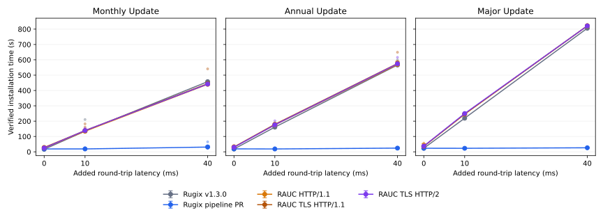
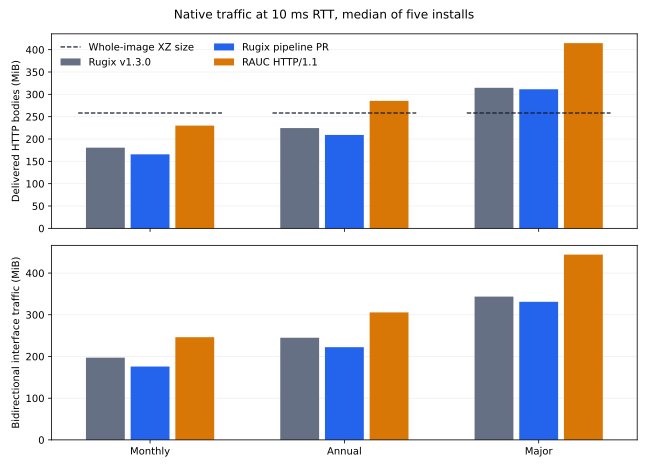

# Native Adaptive-Update Benchmarks

These benchmarks measure installation time and actual network traffic for Rugix and RAUC using real bundles, disposable KVM guests, and Linux network shaping. The [methodology](methodology.md) describes preparation, cache controls, verification, and traffic accounting. The [byte simulations](../delta-updates/README.md) provide the theoretical download-size estimates used in the comparison.

## Findings

At 40 ms added round-trip latency, the monthly pipeline install had a median of **31.0 seconds**, compared with **457.6 seconds** for Rugix v1.3.0. Its median paired speedup was **14.8×** across five repetitions.

At 10 ms RTT, monthly connection counts fell from 2750 to 4. The pipeline delivered 165.69 MiB of HTTP bodies and transferred 175.91 MiB across the link. RAUC HTTP/1.1 delivered 229.97 MiB and transferred 246.12 MiB.

RAUC's monthly HTTP/2 median at 40 ms RTT was 441.8 seconds; verified TLS HTTP/1.1 took 444.5 seconds. All protocol results remain in the tables, including repeated measurements at zero latency.



Lines show medians, error bars show interquartile ranges, and faint dots show individual installs. Monthly pipeline times at 40 ms ranged from 24.2 to 65.0 seconds. All five verified results are retained.

Download savings depend on bundle compression and access patterns. The complete Rugix and RAUC bundles are 330.52 and 362.00 MiB. A whole-image XZ stream is 258.25 MiB. The size figure retains that compression-only reference separately from native traffic.

For the major upgrade at 10 ms RTT, RAUC HTTP/1.1 delivered 414.72 MiB, 1.15 times its complete bundle size. Repeated and overlapping reads count each time. Complete-bundle sizes are byte references; full-download installation times were not measured.



The original 768-byte per-group model gives configuration-dependent errors. For the monthly Casync64 pipeline case, body and full-link factors are 0.968 and 1.028; RAUC 64 KiB factors are 1.283 and 1.373. Separate Casync16 and RAUC 32 KiB measurements support a [provisional calculator calibration](results/2026-10/calculator.md).

The [Faster Delta Updates article](https://rugix.org/blog/faster-delta-updates) presents the design and interpretation. Its source lives in Rugix Docs.

## Measured Conditions

The comparison uses Rugix v1.3.0 at `48fc40d3d903730781f3dc4bf671873d2308573a`, the pipeline PR at `b82749ff34ee8668fb3e53322af039a083e8bf69`, and RAUC 1.15.2. Both Rugix revisions are built with the same pinned compiler. Every tool reconstructs the same 1411.27 MiB payload.

The main campaign contains 225 verified native installs: three workloads, three RTTs, five configurations, and five repetitions. A separate 30-install campaign measures the calculator's Casync16 and RAUC 32 KiB configurations. Earlier exploratory smokes and pilots are excluded.

Each sample uses a fresh guest with four virtual CPUs, 8 GiB RAM, a blank target, prepared indices, and consistent warm caches. Nginx serves bundles over a private veth link. Receiver-side Linux TBF/netem applies 20 MiB/s in each direction and 0, 10, or 40 ms added RTT. The management OS is Debian Bookworm with kernel 6.1.0-35-amd64.

Timing covers the native install command, including fetching, decoding, verification, reconstruction, writes, and index persistence. It excludes boot, preparation, calibration, cache warmup, independent final hashing, and reboot. Actual RTT and throughput are checked before every install. Payload hashes, HTTP protocol, and exact packet/interface counter agreement are required for acceptance.

## Monthly Update

| Installer | 0 ms, s | 10 ms, s | 40 ms, s |
| --- | ---: | ---: | ---: |
| Rugix v1.3.0 | 16.4 [15.8, 17.9] | 134.8 [131.3, 135.1] | 457.6 [457.4, 458.0] |
| Rugix pipeline PR | 18.8 [16.4, 21.5] | 18.8 [17.3, 23.5] | 31.0 [27.2, 40.5] |
| RAUC HTTP/1.1 | 24.9 [23.7, 26.0] | 134.6 [132.6, 138.2] | 440.5 [440.0, 441.0] |
| RAUC TLS HTTP/1.1 | 28.2 [27.8, 29.5] | 138.9 [133.4, 142.9] | 444.5 [441.6, 448.0] |
| RAUC TLS HTTP/2 | 24.9 [24.7, 26.3] | 138.8 [136.4, 140.9] | 441.8 [436.9, 442.7] |

Times are medians with the interquartile range in brackets, from five installs per cell.

## Annual Update

| Installer | 0 ms, s | 10 ms, s | 40 ms, s |
| --- | ---: | ---: | ---: |
| Rugix v1.3.0 | 18.3 [18.2, 18.5] | 160.9 [160.9, 166.1] | 566.2 [565.7, 567.5] |
| Rugix pipeline PR | 19.3 [18.1, 19.9] | 18.6 [17.5, 19.2] | 24.2 [23.8, 25.2] |
| RAUC HTTP/1.1 | 31.0 [30.2, 32.5] | 175.4 [167.7, 177.9] | 570.0 [569.9, 573.0] |
| RAUC TLS HTTP/1.1 | 31.3 [29.9, 33.5] | 179.4 [175.4, 179.9] | 575.9 [573.0, 590.1] |
| RAUC TLS HTTP/2 | 29.6 [28.7, 32.2] | 176.1 [175.8, 182.2] | 574.1 [572.5, 576.1] |

Times are medians with the interquartile range in brackets, from five installs per cell.

## Major Update

| Installer | 0 ms, s | 10 ms, s | 40 ms, s |
| --- | ---: | ---: | ---: |
| Rugix v1.3.0 | 23.2 [22.4, 24.5] | 219.3 [219.2, 219.7] | 805.9 [805.6, 806.0] |
| Rugix pipeline PR | 23.2 [22.1, 24.5] | 23.0 [22.1, 23.0] | 26.4 [26.2, 26.4] |
| RAUC HTTP/1.1 | 36.0 [33.1, 52.7] | 246.0 [242.0, 248.9] | 821.1 [821.0, 822.7] |
| RAUC TLS HTTP/1.1 | 36.0 [35.8, 37.7] | 246.6 [246.4, 251.5] | 821.8 [819.9, 822.5] |
| RAUC TLS HTTP/2 | 37.1 [34.9, 38.6] | 249.6 [244.6, 252.1] | 821.3 [818.0, 822.1] |

Times are medians with the interquartile range in brackets, from five installs per cell.

## Download Size and Traffic

The table uses 10 ms RTT and five repetitions. Body bytes count delivered HTTP response bodies. Link traffic includes both directions, including headers, acknowledgments and retransmissions.

| Update | Installer | Body, MiB | Link Download, MiB | Link Total, MiB | Requests | Connections |
| --- | --- | ---: | ---: | ---: | ---: | ---: |
| Monthly | Rugix v1.3.0 | 180.66 | 190.36 | 197.09 | 2750 | 2750 |
| Monthly | Rugix pipeline PR | 165.69 | 173.65 | 175.91 | 931 | 4 |
| Monthly | RAUC HTTP/1.1 | 229.97 | 243.78 | 246.12 | 9932 | 16 |
| Monthly | RAUC TLS HTTP/1.1 | 229.97 | 244.81 | 247.40 | 9932 | 15 |
| Monthly | RAUC TLS HTTP/2 | 229.97 | 244.19 | 247.32 | 9932 | 1 |
| Annual | Rugix v1.3.0 | 224.50 | 236.55 | 244.96 | 3429 | 3429 |
| Annual | Rugix pipeline PR | 209.08 | 219.07 | 222.28 | 963 | 4 |
| Annual | RAUC HTTP/1.1 | 285.36 | 302.69 | 305.70 | 12933 | 16 |
| Annual | RAUC TLS HTTP/1.1 | 285.36 | 303.93 | 307.27 | 12933 | 15 |
| Annual | RAUC TLS HTTP/2 | 285.36 | 303.11 | 307.17 | 12933 | 1 |
| Major | Rugix v1.3.0 | 314.67 | 331.59 | 343.49 | 4832 | 4832 |
| Major | Rugix pipeline PR | 311.34 | 325.88 | 331.13 | 479 | 4 |
| Major | RAUC HTTP/1.1 | 414.72 | 439.89 | 444.20 | 18723 | 16 |
| Major | RAUC TLS HTTP/1.1 | 414.72 | 441.65 | 446.43 | 18723 | 16 |
| Major | RAUC TLS HTTP/2 | 414.72 | 440.49 | 446.33 | 18723 | 1 |

## Pipeline Speedup

Each ratio pairs a release and pipeline install from the same repetition, workload and RTT.

| Update | RTT | Median Speedup | Paired Range |
| --- | ---: | ---: | ---: |
| Monthly | 0 ms | 0.97× | 0.74–1.26× |
| Monthly | 10 ms | 7.82× | 4.92–8.95× |
| Monthly | 40 ms | 14.75× | 7.09–18.95× |
| Annual | 0 ms | 1.01× | 0.87–1.15× |
| Annual | 10 ms | 8.66× | 6.05–9.71× |
| Annual | 40 ms | 23.50× | 20.00–25.19× |
| Major | 0 ms | 1.00× | 0.57–1.16× |
| Major | 10 ms | 9.67× | 9.20–10.05× |
| Major | 40 ms | 30.58× | 26.19–35.21× |

## Theory and Measured Overhead

The original model includes 768 bytes per downloaded compression group. Its compressed result is compared directly with native delivered bytes and complete link traffic.

| Update | Installer | Model, MiB | Body / Model | Download / Model | Total / Model |
| --- | --- | ---: | ---: | ---: | ---: |
| Monthly | Rugix v1.3.0 | 171.09 | 1.056 | 1.113 | 1.152 |
| Monthly | Rugix pipeline PR | 171.09 | 0.968 | 1.015 | 1.028 |
| Monthly | RAUC HTTP/1.1 | 179.27 | 1.283 | 1.360 | 1.373 |
| Monthly | RAUC TLS HTTP/1.1 | 179.27 | 1.283 | 1.366 | 1.380 |
| Monthly | RAUC TLS HTTP/2 | 179.27 | 1.283 | 1.362 | 1.380 |
| Annual | Rugix v1.3.0 | 216.49 | 1.037 | 1.093 | 1.131 |
| Annual | Rugix pipeline PR | 216.49 | 0.966 | 1.012 | 1.027 |
| Annual | RAUC HTTP/1.1 | 222.46 | 1.283 | 1.361 | 1.374 |
| Annual | RAUC TLS HTTP/1.1 | 222.46 | 1.283 | 1.366 | 1.381 |
| Annual | RAUC TLS HTTP/2 | 222.46 | 1.283 | 1.363 | 1.381 |
| Major | Rugix v1.3.0 | 322.76 | 0.975 | 1.027 | 1.064 |
| Major | Rugix pipeline PR | 322.76 | 0.965 | 1.010 | 1.026 |
| Major | RAUC HTTP/1.1 | 335.64 | 1.236 | 1.311 | 1.323 |
| Major | RAUC TLS HTTP/1.1 | 335.64 | 1.236 | 1.316 | 1.330 |
| Major | RAUC TLS HTTP/2 | 335.64 | 1.236 | 1.312 | 1.330 |
| Monthly | Rugix Casync16 | 170.14 | 0.895 | 0.942 | 0.956 |
| Monthly | RAUC 32 KiB | 180.23 | 1.453 | 1.553 | 1.579 |
| Annual | Rugix Casync16 | 221.49 | 0.887 | 0.932 | 0.945 |
| Annual | RAUC 32 KiB | 226.11 | 1.436 | 1.537 | 1.563 |
| Major | Rugix Casync16 | 369.67 | 0.883 | 0.924 | 0.939 |
| Major | RAUC 32 KiB | 356.86 | 1.385 | 1.482 | 1.507 |

## RAUC Block Reuse

Independent 4 KiB matching must agree with every native RAUC install, including zero blocks and reuse from the already written target prefix.

| Update | Logical Reuse | Missing Raw Data, MiB | Checked Installs |
| --- | ---: | ---: | ---: |
| Monthly | 71.7% | 399.73 | 50 |
| Annual | 58.4% | 587.56 | 50 |
| Major | 27.9% | 1017.69 | 50 |

## Raw Data and Provenance

- [Every accepted sample, CSV](results/2026-10/samples.csv)
- [Main sample records](results/2026-10/paper-samples.json) and [plan](results/2026-10/paper-plan.json)
- [Calculator samples](results/2026-10/calculator-samples.json) and [plan](results/2026-10/calculator-plan.json)
- [Main provenance](results/2026-10/paper-provenance.json) and [calculator provenance](results/2026-10/calculator-provenance.json)
- [Per-workload correction factors](results/2026-10/corrections.json) and [independently checked RAUC reuse](results/2026-10/reuse.json)
- [Theoretical estimates](results/2026-10/theory) and [timing summaries](results/2026-10/summary.json)

Packet captures and full native logs remain in the local campaign cache. Plans, samples, correction factors, and reuse statistics have [Sidex schemas](../schemas/benchmark.sidex). Figures are available as SVG, PDF, and PNG beside the sample data.

## Reproduce

Use x86-64 Linux with writable `/dev/kvm`, Nix, and Podman. See the [methodology](methodology.md) for cache controls, timing boundaries, traffic accounting, and resource requirements. Run these commands from the repository root:

```sh
nix develop path:./nix
uv sync --locked
uv run --locked rugix-benchmarks prepare
uv run --locked rugix-benchmarks smoke
uv run --locked rugix-benchmarks run --plan adaptive-downloads/plans/paper.json --output .cache/paper
uv run --locked rugix-benchmarks run --plan adaptive-downloads/plans/calculator.json --output .cache/calculator
uv run --locked rugix-benchmarks report
```

Successful results resume with immutable input checks. Failed evidence is retained. The reporting command regenerates the benchmark README, tables, figures, calculator proposal, and `adaptive-downloads/results/2026-10/article-data.json` from complete campaigns. Prose templates are in `src/rugix_benchmarks/templates`.

The article is maintained in Rugix Docs. To refresh its interactive graphs in an adjacent checkout:

```sh
cp adaptive-downloads/results/2026-10/article-data.json ../rugix-docs/src/components/native-delta-data.json
```

## Scope

Selected ARM64 filesystems are installed as data in a native x86-64 VM and are not booted. Blank targets keep the comparison aligned with the simulator's single source image; they exclude recovery from a partial install and extra reuse from another older slot. These measurements describe this VM, kernel, network, and selected corpus.

Five repetitions quantify variation within one image pair. They do not create five independent workloads. The calculator calibration covers two Bookworm minor-update pairs and one Bullseye-to-Bookworm upgrade; it does not replace the original two-year corpus. The calculator remains unchanged pending calibration review.

## License

Benchmark code is available under either the Apache-2.0 or MIT license. External tools retain their own licenses.
