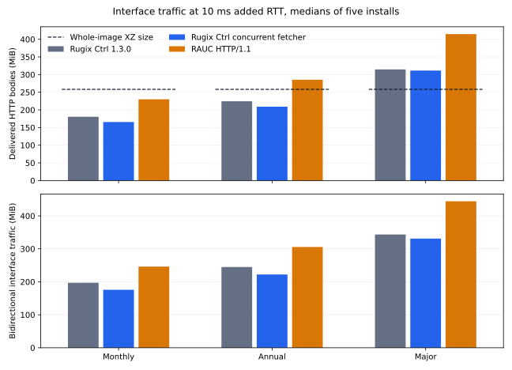

# Dynamic Delta Update Performance

Dynamic delta updates reconstruct a new filesystem image by reusing data already available on a device and downloading the missing parts of an update bundle. This benchmark compares installation time and network traffic for Rugix Ctrl 1.3.0, a Rugix Ctrl build with concurrent HTTP fetching, and RAUC 1.15.2.

For a monthly Debian Bookworm update at 40 ms of added round-trip delay, median installation times were **457.6 seconds with Rugix Ctrl 1.3.0**, **440.5 seconds with RAUC 1.15.2**, and **31.0 seconds with the concurrent fetcher**. These medians come from five installations per configuration on a 20 MiB/s link. At zero added delay, the measurements show no consistent speedup over Rugix Ctrl 1.3.0 across the three tested update pairs.

Read the [results](#results), [reproduce the measurements](#reproduce-the-measurements), or inspect the [measurement data](#data-and-provenance).

## Experiment

Each workload installs the same 1411.27 MiB target filesystem image from a different source image:

| Workload | Source Image | Target Image |
| --- | --- | --- |
| Monthly | Debian Bookworm, May 2025 | Debian Bookworm, June 2025 |
| Annual | Debian Bookworm, June 2024 | Debian Bookworm, June 2025 |
| Major | Debian Bullseye, May 2025 | Debian Bookworm, June 2025 |

ARM64 filesystem images are installed as data by x86-64 installers in KVM guests. Each guest has four virtual CPUs, 8 GiB RAM, a blank target slot, prepared reuse indices, and warm caches. Nginx serves bundles over a private link limited to 20 MiB/s in each direction, with 0, 10, or 40 ms of added round-trip time (RTT).

| Installer Label | Measured Version |
| --- | --- |
| Rugix Ctrl 1.3.0 | Release revision `48fc40d3d903730781f3dc4bf671873d2308573a` |
| Rugix Ctrl concurrent fetcher | Prerelease revision `b82749ff34ee8668fb3e53322af039a083e8bf69` |
| RAUC | 1.15.2 |

Both Rugix Ctrl builds use the same pinned compiler and plain HTTP/1.1. RAUC is measured with plain HTTP/1.1, TLS with HTTP/1.1, and TLS with HTTP/2. Five repetitions of every workload, latency, and installer configuration give 225 main measurements. Each speedup is an installation time with Rugix Ctrl 1.3.0 or RAUC divided by the time with the concurrent fetcher for the same repetition, workload, and latency. Reported speedups are medians of those five ratios.

Rugix Ctrl uses Casync content-defined chunking, which places chunk boundaries according to data content. Its nominal 64 KiB configuration is labeled **Casync64**, and each chunk is compressed individually with XZ. RAUC's `block-hash-index` adaptive update method reuses fixed 4 KiB blocks and retrieves missing data from 64 KiB XZ compression groups in a SquashFS bundle. A compression group contains blocks compressed together, so retrieving one block can require downloading adjacent data.

Installation time covers the install command, including fetching, decompression, verification, reconstruction, writes, and index persistence. VM boot, fixture preparation, network calibration, cache warmup, independent final hashing, and reboot are excluded. Every recorded install passed a target-image hash check and reconciliation of packet captures with interface counters.

| Traffic Metric | Definition |
| --- | --- |
| Body | Delivered HTTP response-body bytes, including bundle metadata and repeated reads. |
| Download | All server-to-client network-interface bytes, including protocol overhead. |
| Total | Network-interface bytes in both directions, including requests, acknowledgments, and retransmissions. |

The [methodology](methodology.md) specifies image construction, network shaping, timing, and verification.

## Results

### Installation Time

At 40 ms added RTT, median speedups across the three workloads ranged from **14.8× to 30.6× over Rugix Ctrl 1.3.0** and **14.2× to 31.1× over RAUC**. Rugix Ctrl 1.3.0 and RAUC had similar median installation times under these conditions; the concurrent fetcher substantially improves on both.

The concurrent fetcher combines adjacent ranges, reuses connections, and keeps several requests in flight. For the monthly update at 10 ms added RTT, it used 4 connections, compared with 2750 for Rugix Ctrl 1.3.0.


Lines show medians, error bars cover the middle 50% of measurements, and dots show individual installs. Monthly times with the concurrent fetcher at 40 ms ranged from 24.2 to 65.0 seconds.

### Network Traffic

For the monthly update at 10 ms added RTT, the concurrent fetcher transferred **175.91 MiB** in both directions, compared with **246.12 MiB** for RAUC over HTTP/1.1, a reduction of **28.5%**. Their delivered response bodies were 165.69 and 229.97 MiB, respectively.



Bundle compression and access patterns affect the savings. The complete Rugix Ctrl and RAUC bundles are 330.52 and 362.00 MiB; compressing the target as a single XZ stream produces 258.25 MiB, shown as a size reference in the figure. Full-download installation times were not measured.

For the major upgrade, RAUC delivered 414.72 MiB of response bodies at 10 ms added RTT, or 1.15 times its bundle size. Response-body counts include repeated and overlapping reads.

### Accuracy of Download Size Estimates

The [byte simulations](../delta-updates/README.md) estimate compressed data and indices with 768 bytes of transfer overhead per downloaded compression group. A correction factor divides measured bytes by that estimate: values above one indicate an underestimate, and values below one indicate an overestimate.

For the monthly Casync64 update, the concurrent fetcher's body and total-traffic factors are 0.968 and 1.028. RAUC's corresponding factors with 64 KiB compression groups are 1.283 and 1.373.

A separate 30-install calibration measures the same Rugix Ctrl concurrent fetcher with nominal 16 KiB chunks (**Casync16**) and RAUC 1.15.2 with 32 KiB compression groups. Both use plain HTTP/1.1. The [calibration report](results/2026-10/calculator.md) provides factors for the savings calculator's models and explains their applicability.

## Reproduce the Measurements

Use x86-64 Linux with writable `/dev/kvm`, Nix with flakes enabled, and Podman. Allow at least 12 GiB of free RAM and about 150 GiB of disk space for images, builds, and captures. Run one campaign at a time on an otherwise idle host.

From `benchmarks/dynamic-downloads`, prepare the inputs, check the installers, run both measurement plans, and generate the report:

```sh
nix develop path:./nix
uv sync --locked
uv run --locked benchmark prepare
uv run --locked benchmark smoke
uv run --locked benchmark run --plan plans/paper.json --output .cache/paper
uv run --locked benchmark run --plan plans/calculator.json --output .cache/calculator
uv run --locked benchmark report
```

A successful report confirms 225 main and 30 calibration installs and writes results to `results/2026-10/`. It regenerates this README, measurement tables, figures, and the calibration report. See [Run Management](methodology.md#run-management) for resuming interrupted campaigns and handling failed runs.

## Detailed Results

Installation times are medians with first and third quartiles in brackets. Traffic tables show medians of five measurements per condition.

### Monthly Update

| Installer | 0 ms, s | 10 ms, s | 40 ms, s |
| --- | ---: | ---: | ---: |
| Rugix Ctrl 1.3.0 | 16.4 [15.8, 17.9] | 134.8 [131.3, 135.1] | 457.6 [457.4, 458.0] |
| Rugix Ctrl concurrent fetcher | 18.8 [16.4, 21.5] | 18.8 [17.3, 23.5] | 31.0 [27.2, 40.5] |
| RAUC HTTP/1.1 | 24.9 [23.7, 26.0] | 134.6 [132.6, 138.2] | 440.5 [440.0, 441.0] |
| RAUC TLS HTTP/1.1 | 28.2 [27.8, 29.5] | 138.9 [133.4, 142.9] | 444.5 [441.6, 448.0] |
| RAUC TLS HTTP/2 | 24.9 [24.7, 26.3] | 138.8 [136.4, 140.9] | 441.8 [436.9, 442.7] |

Columns show added round-trip time in milliseconds. Installation times are seconds, shown as median [first quartile, third quartile] from five installs.

### Annual Update

| Installer | 0 ms, s | 10 ms, s | 40 ms, s |
| --- | ---: | ---: | ---: |
| Rugix Ctrl 1.3.0 | 18.3 [18.2, 18.5] | 160.9 [160.9, 166.1] | 566.2 [565.7, 567.5] |
| Rugix Ctrl concurrent fetcher | 19.3 [18.1, 19.9] | 18.6 [17.5, 19.2] | 24.2 [23.8, 25.2] |
| RAUC HTTP/1.1 | 31.0 [30.2, 32.5] | 175.4 [167.7, 177.9] | 570.0 [569.9, 573.0] |
| RAUC TLS HTTP/1.1 | 31.3 [29.9, 33.5] | 179.4 [175.4, 179.9] | 575.9 [573.0, 590.1] |
| RAUC TLS HTTP/2 | 29.6 [28.7, 32.2] | 176.1 [175.8, 182.2] | 574.1 [572.5, 576.1] |

Columns show added round-trip time in milliseconds. Installation times are seconds, shown as median [first quartile, third quartile] from five installs.

### Major Update

| Installer | 0 ms, s | 10 ms, s | 40 ms, s |
| --- | ---: | ---: | ---: |
| Rugix Ctrl 1.3.0 | 23.2 [22.4, 24.5] | 219.3 [219.2, 219.7] | 805.9 [805.6, 806.0] |
| Rugix Ctrl concurrent fetcher | 23.2 [22.1, 24.5] | 23.0 [22.1, 23.0] | 26.4 [26.2, 26.4] |
| RAUC HTTP/1.1 | 36.0 [33.1, 52.7] | 246.0 [242.0, 248.9] | 821.1 [821.0, 822.7] |
| RAUC TLS HTTP/1.1 | 36.0 [35.8, 37.7] | 246.6 [246.4, 251.5] | 821.8 [819.9, 822.5] |
| RAUC TLS HTTP/2 | 37.1 [34.9, 38.6] | 249.6 [244.6, 252.1] | 821.3 [818.0, 822.1] |

Columns show added round-trip time in milliseconds. Installation times are seconds, shown as median [first quartile, third quartile] from five installs.

### Download Size and Traffic

Values are medians of five installs at 10 ms added RTT. Body counts delivered HTTP response-body bytes; Link Download counts server-to-client interface bytes; Link Total includes interface traffic in both directions.

| Update | Installer | Body, MiB | Link Download, MiB | Link Total, MiB | Requests | Connections |
| --- | --- | ---: | ---: | ---: | ---: | ---: |
| Monthly | Rugix Ctrl 1.3.0 | 180.66 | 190.36 | 197.09 | 2750 | 2750 |
| Monthly | Rugix Ctrl concurrent fetcher | 165.69 | 173.65 | 175.91 | 931 | 4 |
| Monthly | RAUC HTTP/1.1 | 229.97 | 243.78 | 246.12 | 9932 | 16 |
| Monthly | RAUC TLS HTTP/1.1 | 229.97 | 244.81 | 247.40 | 9932 | 15 |
| Monthly | RAUC TLS HTTP/2 | 229.97 | 244.19 | 247.32 | 9932 | 1 |
| Annual | Rugix Ctrl 1.3.0 | 224.50 | 236.55 | 244.96 | 3429 | 3429 |
| Annual | Rugix Ctrl concurrent fetcher | 209.08 | 219.07 | 222.28 | 963 | 4 |
| Annual | RAUC HTTP/1.1 | 285.36 | 302.69 | 305.70 | 12933 | 16 |
| Annual | RAUC TLS HTTP/1.1 | 285.36 | 303.93 | 307.27 | 12933 | 15 |
| Annual | RAUC TLS HTTP/2 | 285.36 | 303.11 | 307.17 | 12933 | 1 |
| Major | Rugix Ctrl 1.3.0 | 314.67 | 331.59 | 343.49 | 4832 | 4832 |
| Major | Rugix Ctrl concurrent fetcher | 311.34 | 325.88 | 331.13 | 479 | 4 |
| Major | RAUC HTTP/1.1 | 414.72 | 439.89 | 444.20 | 18723 | 16 |
| Major | RAUC TLS HTTP/1.1 | 414.72 | 441.65 | 446.43 | 18723 | 16 |
| Major | RAUC TLS HTTP/2 | 414.72 | 440.49 | 446.33 | 18723 | 1 |

### Rugix Ctrl Speedup

Each speedup is the Rugix Ctrl 1.3.0 time divided by the concurrent fetcher time for the same repetition, workload, and added RTT. The table gives the median and full range of five paired ratios.

| Update | RTT | Median Speedup | Paired Range |
| --- | ---: | ---: | ---: |
| Monthly | 0 ms | 0.97× | 0.74–1.26× |
| Monthly | 10 ms | 7.82× | 4.92–8.95× |
| Monthly | 40 ms | 14.75× | 7.09–18.95× |
| Annual | 0 ms | 1.01× | 0.87–1.15× |
| Annual | 10 ms | 8.66× | 6.05–9.71× |
| Annual | 40 ms | 23.50× | 20.00–25.19× |
| Major | 0 ms | 1.00× | 0.57–1.16× |
| Major | 10 ms | 9.67× | 9.20–10.05× |
| Major | 40 ms | 30.58× | 26.19–35.21× |

### Theory and Measured Overhead

The model estimates compressed data and index bytes plus 768 bytes per downloaded compression group. Each factor is measured bytes divided by modeled bytes: values above one indicate an underestimate. Main configurations use five installs at 10 ms added RTT; Casync16 and RAUC 32 KiB use five installs at zero added RTT.

| Update | Installer | Model, MiB | Body / Model | Download / Model | Total / Model |
| --- | --- | ---: | ---: | ---: | ---: |
| Monthly | Rugix Ctrl 1.3.0 | 171.09 | 1.056 | 1.113 | 1.152 |
| Monthly | Rugix Ctrl concurrent fetcher | 171.09 | 0.968 | 1.015 | 1.028 |
| Monthly | RAUC HTTP/1.1 | 179.27 | 1.283 | 1.360 | 1.373 |
| Monthly | RAUC TLS HTTP/1.1 | 179.27 | 1.283 | 1.366 | 1.380 |
| Monthly | RAUC TLS HTTP/2 | 179.27 | 1.283 | 1.362 | 1.380 |
| Annual | Rugix Ctrl 1.3.0 | 216.49 | 1.037 | 1.093 | 1.131 |
| Annual | Rugix Ctrl concurrent fetcher | 216.49 | 0.966 | 1.012 | 1.027 |
| Annual | RAUC HTTP/1.1 | 222.46 | 1.283 | 1.361 | 1.374 |
| Annual | RAUC TLS HTTP/1.1 | 222.46 | 1.283 | 1.366 | 1.381 |
| Annual | RAUC TLS HTTP/2 | 222.46 | 1.283 | 1.363 | 1.381 |
| Major | Rugix Ctrl 1.3.0 | 322.76 | 0.975 | 1.027 | 1.064 |
| Major | Rugix Ctrl concurrent fetcher | 322.76 | 0.965 | 1.010 | 1.026 |
| Major | RAUC HTTP/1.1 | 335.64 | 1.236 | 1.311 | 1.323 |
| Major | RAUC TLS HTTP/1.1 | 335.64 | 1.236 | 1.316 | 1.330 |
| Major | RAUC TLS HTTP/2 | 335.64 | 1.236 | 1.312 | 1.330 |
| Monthly | Rugix Ctrl Casync16 | 170.14 | 0.895 | 0.942 | 0.956 |
| Monthly | RAUC 32 KiB | 180.23 | 1.453 | 1.553 | 1.579 |
| Annual | Rugix Ctrl Casync16 | 221.49 | 0.887 | 0.932 | 0.945 |
| Annual | RAUC 32 KiB | 226.11 | 1.436 | 1.537 | 1.563 |
| Major | Rugix Ctrl Casync16 | 369.67 | 0.883 | 0.924 | 0.939 |
| Major | RAUC 32 KiB | 356.86 | 1.385 | 1.482 | 1.507 |

### RAUC Block Reuse

Logical Reuse is the fraction of target 4 KiB blocks supplied by source blocks, zero data, or data already written to the target. Missing Raw Data counts the remaining blocks before compression. For every checked install, RAUC reuse counters matched an independent block comparison.

| Update | Logical Reuse | Missing Raw Data, MiB | Checked Installs |
| --- | ---: | ---: | ---: |
| Monthly | 71.7% | 399.73 | 50 |
| Annual | 58.4% | 587.56 | 50 |
| Major | 27.9% | 1017.69 | 50 |

## Data and Provenance

| Data | Contents |
| --- | --- |
| [Samples, CSV](results/2026-10/samples.csv) | All 255 recorded installations. |
| [Main samples](results/2026-10/paper-samples.json) and [plan](results/2026-10/paper-plan.json) | Installation-time and traffic measurements for the five main configurations. |
| [Calibration samples](results/2026-10/calculator-samples.json) and [plan](results/2026-10/calculator-plan.json) | Casync16 and RAUC 32 KiB measurements. |
| [Main provenance](results/2026-10/paper-provenance.json) and [calibration provenance](results/2026-10/calculator-provenance.json) | Input identities, software versions, hashes, and recorded environment. |
| [Correction factors](results/2026-10/corrections.json) | Measured-to-modeled byte ratios. |
| [RAUC reuse](results/2026-10/reuse.json) | Independently checked block-reuse counts. |
| [Theoretical estimates](results/2026-10/theory/) | Compressed sizes from the byte models. |
| [Timing summaries](results/2026-10/summary.json) and [tables](results/2026-10/tables.md) | Timing statistics and complete result tables. |

Packet captures and installer logs are written to each local campaign's `runs/` directory. The figures are available as SVG, PDF, and PNG in `results/2026-10/`; [Sidex definitions](schemas/benchmark.sidex) describe the machine-readable records.

## Scope

The measurements cover three image pairs on the specified VM, kernel, network, and warm-cache setup. Each target starts blank, so partial-install recovery is outside the measured workload. Five repetitions characterize variation within each image pair; the calibration covers two Bookworm minor updates and one Bullseye-to-Bookworm upgrade.

## License

Benchmark code is available under either the Apache-2.0 or MIT license. External tools retain their own licenses.
